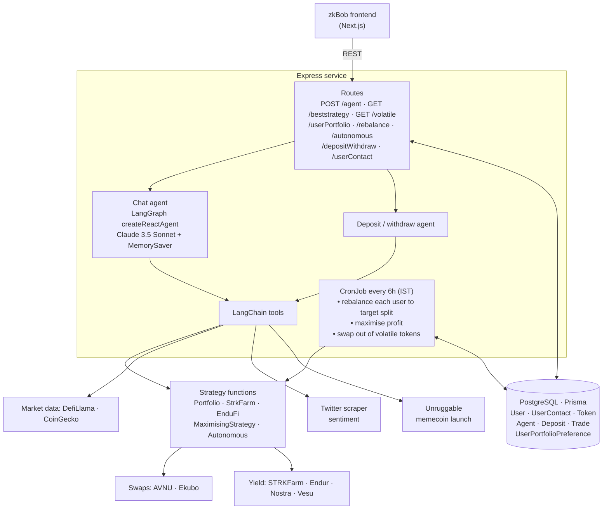

# HackerGames_backend

### Backend for zkBob, an autonomous AI DeFi agent on Starknet

🏆 **1st place, Agentic track, Starknet Hacker Games** · Frontend: [StarknetHackerGames](https://github.com/Devanshgoel-123/StarknetHackerGames)


An Express + LangGraph service that turns chat prompts into Starknet DeFi actions. It also runs scheduled strategies: portfolio rebalancing, profit maximisation, and volatility swaps.

## Architecture



## Agent tools

| Tool | Purpose |
|---|---|
| `get_token_details`, `get_token_exchange_data` | Price, volume history, and exchange data for Starknet tokens |
| `get_supported_tokens`, `execute_swap` | Token swaps routed through AVNU |
| `deposit_token_starkfarm`, `withdraw_token_starkfarm` | STRKFarm vault deposits and withdrawals |
| `deposit_token_endufi`, `withdraw_token_endufi` | Endur liquid staking |
| `get_pool_details` | Answers questions about pool APYs and TVL |
| `analyze_starknet_sentiment` | Twitter sentiment for the Starknet ecosystem, plus a trading recommendation |
| `create_memecoin`, `launch_memecoin` | Launch tokens through Unruggable |
| `generate_suggestions`, `cache_chat` | Suggested follow-up prompts and conversation memory |

## Scheduled jobs

All three jobs run every 6 hours (`0 0 */6 * * *`, Asia/Kolkata):

- **Rebalancer.** For every saved `UserPortfolioPreference`, it swaps the portfolio back to the user's target split of stablecoins, native tokens, and other assets.
- **Profit maximiser.** Moves delegated funds into the best available strategy.
- **Volatility guard.** Finds volatile holdings and swaps out of them.

## Getting started

```bash
git clone https://github.com/Devanshgoel-123/HackerGames_backend.git
cd HackerGames_backend
pnpm install
cp .env.example .env      # fill in the values below
npx prisma migrate deploy
pnpm dev                  # http://localhost:3002
```

| Variable | Purpose |
|---|---|
| `DATABASE_URL`, `DIRECT_URL` | PostgreSQL connection strings |
| `ANTHROPIC_API_KEY`, `OPEN_AI_API_KEY`, `GEMINI_API_KEY` | LLM providers |
| `COINMARKETCAP_API_KEY`, `HISTORY_API_KEY`, `BLOCK_API_KEY`, `ALCHEMY_API_KEY` | Market and chain data |
| `TWITTER_USERNAME`, `TWITTER_PASSWORD`, `TWITTER_EMAIL` | Account used by the sentiment scraper |
| `WALLET_ADDRESS`, `PVT_KEY`, `STARKNET_PROVIDER_URL` | Agent wallet and RPC (keep these out of git) |

## Project structure

```
src
├── index.ts         Express app, routes, cron jobs
├── Agents/          Chat and deposit agents, system prompts
├── tools/           LangChain tools (swap, yield, data, sentiment, memecoins)
├── Functions/       Strategy logic: portfolio, StrkFarm, EnduFi, autonomous trading
├── Routes/          Express routers
├── utils/           RPC, Ekubo, and DeFi helpers
└── config/, constants/, types/
prisma/schema.prisma
```
